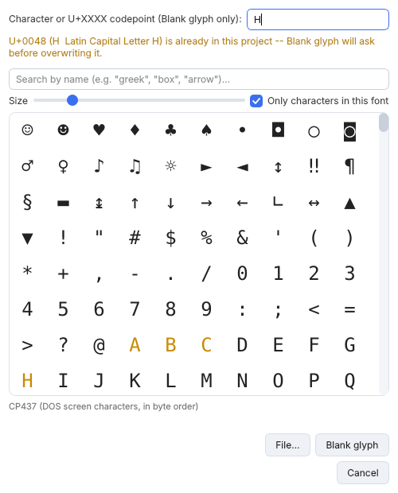
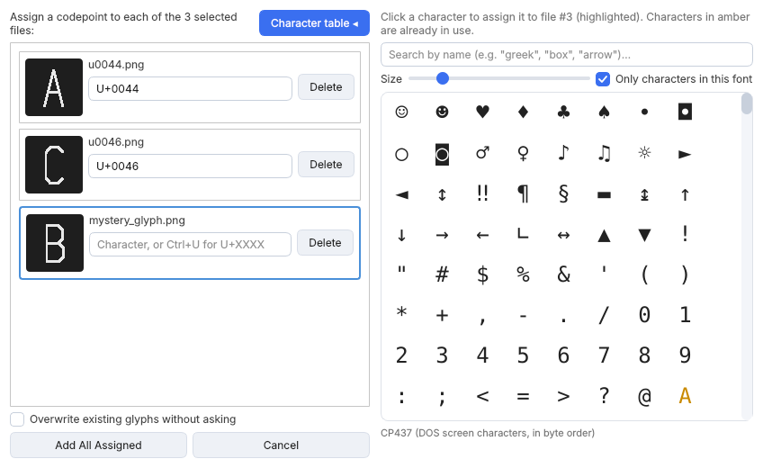

# Adding glyphs

Beyond importing a whole `u<hex>.png` folder at once (see [Getting started](getting-started.md)), **Add Glyph…** on the toolbar adds glyphs one at a time or in a batch, either from existing PNG files or completely from scratch.

- **File…** is always enabled, regardless of whether anything is typed into the character field above it. Picking one file or several both route to the same place — the assignment review window below — so there's no reason to require a codepoint before you've even chosen what you're assigning it to.
- **Blank glyph** draws a glyph from scratch with no source image, and needs a character or `U+XXXX` codepoint typed into the field first — there's no file content to preview that would make asking for it afterward mean anything. Entering an invalid value keeps the dialog open so you can correct it, rather than closing and forcing you to start over.
- The character/codepoint field is scoped to **Blank glyph only** — it plays no role in a File… pick, even for a single file.
- Below the field, a line names the entered character and warns straight away when it's **already in the project** (Blank glyph still asks before overwriting it). Under that is the **character table** (see [Capture mode](capture.md#assigning-codes)): a click fills the field, a double-click also creates the blank glyph. Characters already in the project are shown in amber.

There's no Capture option in this dialog. **Capture Glyphs…**, PNGlyph's dedicated multi-capture flow, already covers a single capture at least as well — see [Capture mode](capture.md).

## Assigning codepoints to files

Every File… pick — one file or many — opens the same "Assign codepoints" review window, with one row per file: a real thumbnail, an editable codepoint field, and a way to drop that file from the batch.

- Files named `u<hex>.png` are auto-recognized and pre-filled from their own filename — no other filename pattern is guessed automatically, since a bare `A.png` or similar carries no real certainty about which codepoint it means.
- Files named with **only a number** — `000.png` … `255.png`, the way a font exporter writes a font's glyphs out in byte order — can be filled in one go, but only once you say what the numbers mean: see "Numbered files" below.
- Rows without a code are listed in number order (`9.png` before `10.png`), so a numbered set appears in its own sequence.
- If two files in the same batch would guess the same codepoint, both are left blank instead of silently letting one collide with the other — resolve the conflict by hand.
- **Overwrite existing glyphs without asking**, unchecked by default, lets an assigned codepoint replace one that already exists in the project without a confirmation per row.
- **Add All Assigned** commits every row that currently has a valid codepoint; rows left blank are simply skipped.
- **Character table ▸** opens the same side panel as in the Capture window: click a row to highlight it, then click a character to assign it — the next file without a code is highlighted next.

### Numbered files (character codes)

When at least one selected file is named with nothing but a number, the window shows **Filenames are character codes in code page:** with the code-page list on the line below it. Tick it and each numbered file gets the character its number stands for in that code page — for **CP437 – DOS screen glyphs** (the default):

- `065.png` → `A`, `128.png` → `Ç`, `224.png` → `α`
- `001.png` → `☺`, `010.png` → `◙`, `127.png` → `⌂` — the characters DOS showed on screen for those bytes, not the control codes they also stand for (see [Capture mode](capture.md#assigning-codes) for why a font needs the screen reading).

The number is a byte, so it always goes through a code page: taken literally, `130.png` would land on U+0082, an invisible control code, instead of `é`. Pick a different code page from the list if the source used one (CP850, Windows-1252 …); the choice is remembered, the checkbox itself starts unticked for every batch.

Rules:

- Only rows that are still blank are filled. A code you typed, picked from the character table, or that came from a `u<hex>` name is never replaced — switching code page or unticking the option only changes or clears what the option itself filled in.
- Numbers above 255 (not a byte — for example the extra, redundant entries at the end of a font file) and bytes with no glyph (`000.png`) are left blank.
- A character another row in the batch already has, or that two numbered files would both get, is left blank on those rows.
- Characters already in the project: you're asked **once** for the whole batch whether to assign them anyway (they replace the existing glyphs when added) or leave those rows blank — unless **Overwrite existing glyphs without asking** is ticked.
- A line under the checkbox says how many rows were filled and why any were left blank.

Nothing is added until **Add All Assigned**, and every row can still be corrected by hand.

If every file in a batch is unambiguous — recognized by filename, no conflicts — the glyphs are added immediately with no review window shown at all.
