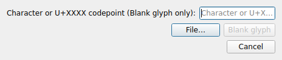
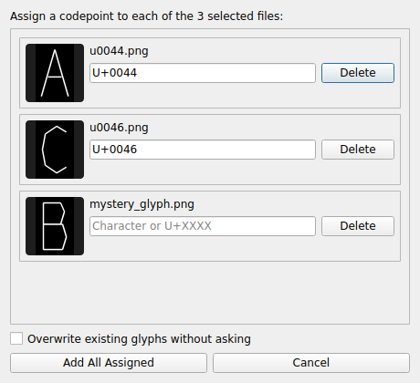

# Adding glyphs

Beyond importing a whole `u<hex>.png` folder at once (see [Getting started](getting-started.md)), **Add Glyph…** on the toolbar adds glyphs one at a time or in a batch, either from existing PNG files or completely from scratch.

- **File…** is always enabled, regardless of whether anything is typed into the character field above it. Picking one file or several both route to the same place — the assignment review window below — so there's no reason to require a codepoint before you've even chosen what you're assigning it to.
- **Blank glyph** draws a glyph from scratch with no source image, and needs a character or `U+XXXX` codepoint typed into the field first — there's no file content to preview that would make asking for it afterward mean anything. Entering an invalid value keeps the dialog open so you can correct it, rather than closing and forcing you to start over.
- The character/codepoint field is scoped to **Blank glyph only** — it plays no role in a File… pick, even for a single file.

There's no Capture option in this dialog. **Capture Glyphs…**, PNGlyph's dedicated multi-capture flow, already covers a single capture at least as well — see [Capture mode](capture.md).

## Assigning codepoints to files

Every File… pick — one file or many — opens the same "Assign codepoints" review window, with one row per file: a real thumbnail, an editable codepoint field, and a way to drop that file from the batch.

- Files named `u<hex>.png` are auto-recognized and pre-filled from their own filename — no other filename pattern is guessed, since a bare `A.png` or similar carries no real certainty about which codepoint it means.
- If two files in the same batch would guess the same codepoint, both are left blank instead of silently letting one collide with the other — resolve the conflict by hand.
- **Overwrite existing glyphs without asking**, unchecked by default, lets an assigned codepoint replace one that already exists in the project without a confirmation per row.
- **Add All Assigned** commits every row that currently has a valid codepoint; rows left blank are simply skipped.

If every file in a batch is unambiguous — recognized by filename, no conflicts — the glyphs are added immediately with no review window shown at all.
