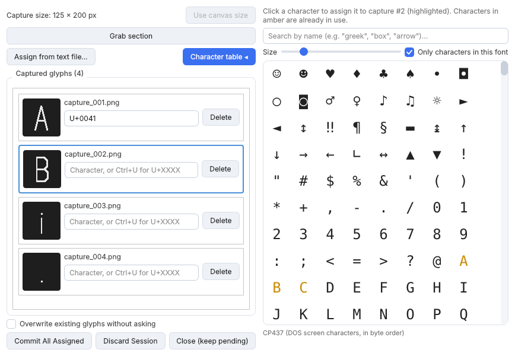
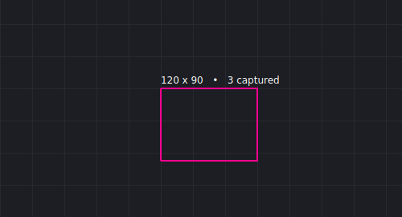
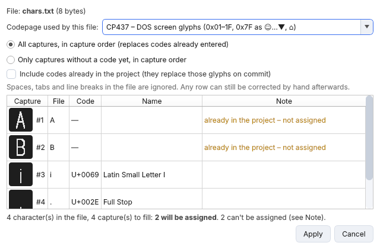
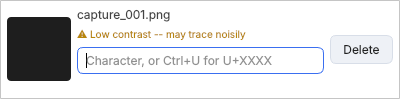

# Capture mode

**Capture Glyphs…** on the toolbar builds glyphs directly from screen-grabbed regions of any on-screen reference — another app, a scanned sheet, anything visible on screen — without needing to prepare individual PNG files by hand first.

## Starting a session

Click **Capture Glyphs…** to open the **Capture** window and switch focus to whatever's currently on screen (PNGlyph's own main window hides for the duration). This one window handles the whole session — grabbing, reviewing, and assigning codepoints all live together here, so there's nothing else to open or switch to:



- **Captured glyphs (N)** — the group box title is a live count of everything queued in this session so far, with one row per capture below it: a thumbnail and an editable codepoint field, same as the multi-file "Assign codepoints" review window (see [Adding glyphs](adding-glyphs.md#assigning-codepoints-to-files)).
- **Spacing (px)** shows the current fixed-size rectangle, once one exists — carried over from the last time you captured anything (this session or a previous one), so most sessions start with a size already in place.
- **Use canvas size** sets the capture rectangle to match the current project's own canvas size in one click. It's disabled — with a tooltip explaining why — when there's no project, or when the project's canvas size isn't genuinely established yet (for example, a brand-new project created just for this capture session, whose canvas size is only a provisional placeholder until the session commits).
- **Grab section** freezes the current on-screen view for cropping. Hover it for a reminder of the zoom/SHIFT/CTRL gestures below.
- **Assign from text file…** and **Character table** — two faster ways to give captures their codes, see "Assigning codes" below.
- **Commit All Assigned**, **Discard Session**, and **Close (keep pending)** — see "Finishing up" below.

## Grabbing a section

Clicking **Grab section** hides the Capture window, freezes a screenshot, and switches to crosshair positioning over it:



- **Plain click** commits the current fixed-size rectangle at the cursor — the normal, fast path once a size is established.
- **Hold SHIFT** to draw a new rectangle instead of using the fixed size — click one corner, move, click the opposite corner. SHIFT only needs to be held for the first click.
- **CTRL** toggles snapping to a nearby corner, line, or point on/off — it's a toggle, not a held modifier, so it stays as set rather than needing to be held down.
- **Right-click**, or **Escape** with nothing pending, cancels back to the Capture window. Escape with a SHIFT-started corner already placed cancels just that pending rectangle instead.
- Keep your zoom level constant for the whole session — changing it forces resizing captures to match, which can hurt detection.

The rectangle's own dimension label doubles as a live zoom-consistency check (a size that suddenly differs from your last capture is the visible sign of a zoom change) and carries the running capture count too, right where your attention already is while positioning. Capture size and the snap toggle's own on/off state don't get a separate on-screen readout at all — both are already covered by the Grab section button's own tooltip, and the Capture window itself reappears the moment you're not actively capturing.

The Capture window hides completely while you're positioning a capture — it would otherwise sit on top of part of whatever you're trying to grab — and reappears automatically once you're done, whether that's a successful capture, a cancelled grab, or a failed one.

## Assigning codes

Each capture row needs a codepoint before it can be committed. The **active** row — highlighted with a blue outline — is the one the character table assigns to; click a row (or its field) to make it active. Thumbnails are drawn from the exact ink tracing will see, shrunk so that every stroke stays at least visible — a one-pixel line or a lone dot no longer fades away.

**Typing.** A single character typed into an empty field is assigned immediately and moves on to the next row. For a code by number press **Ctrl+U** — the field shows `U+` and takes hex digits, committing after the fourth (or on Enter). The field's grey hint text says so too. Right-click a field to open the character table as a pop-up instead.

**Character table.** **Character table ▸** opens the table as a panel on the right of the Capture window — the window grows rightwards, so the capture rows never get covered. **Clicking a character assigns it to the active row** and moves on to the next capture still without a code. Characters already in use — in the project, or assigned elsewhere in this session — are shown in amber, so a clash is visible before clicking. The table:

- starts with the full **CP437 (DOS screen)** character set in byte order, followed by the Unicode blocks those characters live in (Latin, Greek, Cyrillic, punctuation, arrows, maths, box drawing, block elements, geometric shapes, symbols);
- is drawn in the bundled **DejaVu Sans Mono**, which has every CP437 character — so every cell looks consistent, and **Only characters in this font** hides anything the font can't show;
- has a **Size** slider for larger characters, and a name search ("spade", "box", "arrow"…).

The panel's open/closed state and the size are remembered.

**Assign from text file….** Instead of assigning every capture by hand, type the captured characters into a plain text file **in the same order you captured them**, and load it here. For example, after grabbing a program's character-chart screen row by row, left to right:

```
ABCDEFGHIJKLM
NOPQRSTUVWXYZ
0123456789
.,:;!?+-*/=
```

The first capture becomes `A`, the 14th `N`, the last `=`. The line breaks only mirror the screen's rows and aren't counted. If the source program stored its text in an old DOS codepage (a file saved by a DOS editor, a code page chart of a DOS application), you can use its own bytes directly — for instance a CP437 file whose first bytes are `01 02 03 04` gives ☺ ☻ ♥ ♦.

Loading the file:

1. Choose the file, then the codepage it uses. **CP437 – DOS screen glyphs** reads bytes 0x01–0x1F and 0x7F as the characters DOS showed on screen (☺ ☻ ♥ … ▲ ▼, ⌂); **CP437 – standard** treats them as control codes, which have no glyph. Other DOS/Windows codepages and UTF-8 are offered too; the most likely one is preselected.
2. A preview shows every capture's thumbnail beside the character it would get, with a note wherever something won't be assigned.

   
3. **Apply** fills in the codes — nothing is committed until you click **Commit All Assigned**, and any row can still be corrected by hand.

Rules: spaces, tabs and line breaks in the file are ignored (lay it out however you like); every other character takes exactly one capture's slot, in order. A character with no glyph (a control code, an undefined byte) still takes its slot — it doesn't shift the rest — and that capture is left without a code. A code another capture already has is not assigned twice, and codes already in the project are only assigned when **Include codes already in the project** is ticked (they replace those glyphs on commit). **Only captures without a code yet** fills just the gaps. If the counts don't match, the preview says so.

Why the codepage matters, and why 0x0A/0x0D aren't lost: a TrueType font maps glyphs to **Unicode** characters, not to codepage bytes. ◙ (CP437 0x0A on screen) belongs at U+25D9, while line feed stays U+000A — exactly as in any other font. Placing glyphs *at* U+0000–001F instead would be useless: text renderers treat those as control codes and never draw them.

## What makes a good capture

The same requirement [Getting started](getting-started.md#what-makes-a-workable-source-png) sets for a prepared PNG applies here too: tracing needs a genuinely flat, high-contrast, essentially two-tone source. Polarity (which color is ink) is worked out automatically, so a light-on-dark or dark-on-light capture both trace correctly with nothing to configure — but that detection still depends on the source actually being close to two flat tones to begin with, and a live on-screen capture is far more likely to fall short of that than a purpose-prepared PNG, even when it looks clean by eye: real font smoothing and anti-aliasing carry genuine in-between pixel values along every edge, which is exactly what shows up afterward as small, unwanted deviations on what should be straight segments.

A capture that looks likely to trace noisily gets flagged right in its row, in the Capture window itself:



The full explanation is in the warning's own tooltip. It's advisory, not a block — you can still assign a codepoint and commit it regardless — but it's worth checking before spending time on one. Ink and background are classified against two fixed brightness bars rather than something that adapts per image, deliberately: an adaptive version was tried and reverted after it was confirmed to occasionally fail in a way that looked confidently right but wasn't, rather than failing in an obviously visible way — see [Getting started](getting-started.md#what-makes-a-workable-source-png) for the fuller reasoning. The practical result is that there's no clever fallback for a source that isn't genuinely flat — if you can, a source rendered without font smoothing beats a screenshot of normally-rendered text every time, for the same reason a flat, purpose-prepared PNG traces more reliably than a photo of the same letterform, and if a capture keeps warning, running it through an ordinary image editor's contrast/levels tool first (IrfanView and other free tools all work fine) is the fix, not a PNGlyph setting.

## Finishing up

- **Commit All Assigned** adds every row with a valid codepoint to the project. Rows still missing one are simply left pending — you're asked to confirm if any exist, and the window stays open afterward if some rows weren't committed, closes if everything was.
- **Discard Session** throws away everything captured so far, after confirming.
- **Close (keep pending)** leaves everything captured untouched and closes the window — resume later from **Capture Glyphs…** again.

The titlebar X and Escape both do the same thing as **Close (keep pending)** — suspend the session, keep everything queued, nothing lost. There's no separate "end session" action distinct from these three; between them they cover every way a session actually ends.

A capture size persists across sessions, and across restarting PNGlyph entirely, so you don't need to redefine it every time — SHIFT-drawing a new rectangle mid-session redefines it going forward from that point on.
