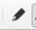
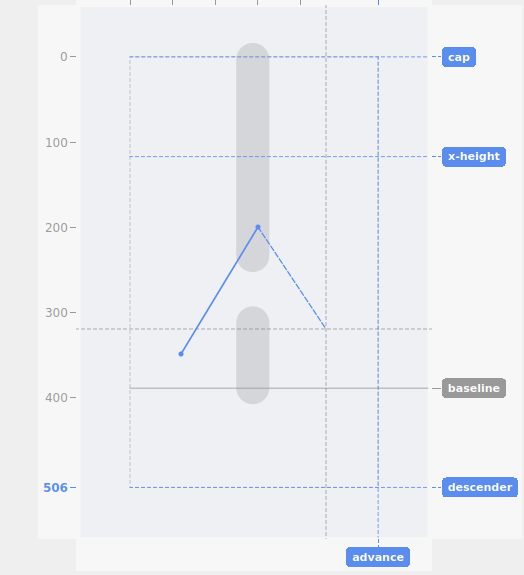
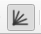
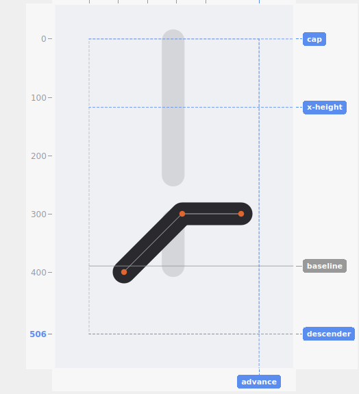
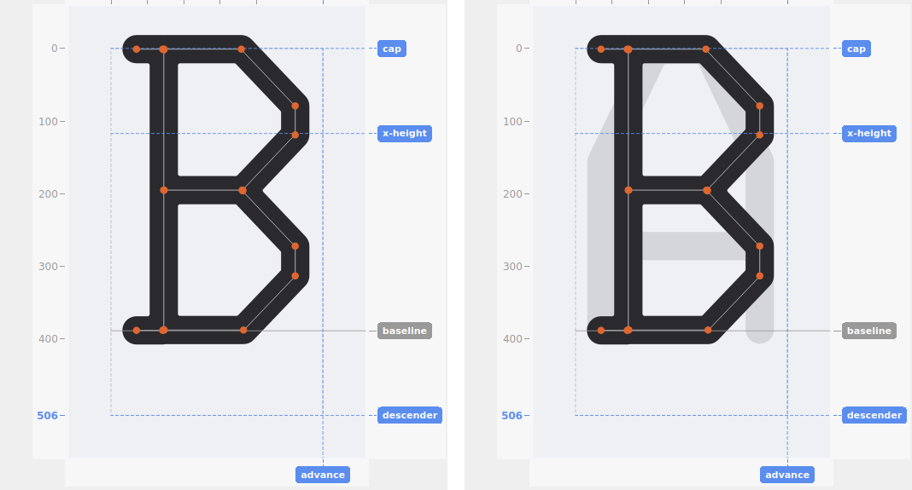

# Drawing

## The pen tool

Click the **Draw** toolbar icon to enter drawing mode. **Left-click** places a new point; consecutive points connect into a new stroke, previewed live as you go. **Right-click-drag** still pans the canvas exactly as it does outside drawing mode, so you can reposition the view mid-stroke without leaving Draw mode or losing your in-progress points.

Only straight segments can be drawn — there's no curve or arc tool. A curved shape is built the same way a DOS-era bitmap font would trace one: as a series of short, straight segments.

- **Enter/Return** finishes the current stroke, committing it as a new path.
- **Double-click** (left button) also finishes the stroke, as an alternative to Enter — with one small difference worth knowing: the second click of the pair places its own point too, before Qt recognizes it as a double-click at all. If that second click landed close to the previous point (ordinary hand tremor between two fast clicks), it's discarded automatically; if it landed meaningfully further away, it's kept as one final, real point of the stroke. Enter alone never adds this extra point.
- **Backspace** removes the last-placed point, one click at a time — useful for undoing a single misplaced click without discarding the whole stroke.
- **Escape** or **Delete** discards the entire in-progress stroke.

You can draw several separate strokes in one drawing session (finish one with Enter, then continue drawing another) before leaving Draw mode.

## Snapping while drawing

Ordinary snap settings — grid, segments, x-height/baseline — all apply while placing points with the pen tool, exactly as they do when dragging an existing point. See [Snapping](snapping.md) for the full rundown, including the G/S/H toggle keys.

A new stroke can snap onto an **earlier segment of that same, still-in-progress stroke**, not just already-committed glyph geometry — useful for closing a shape back onto its own starting point.

## Angle-snap while drawing

With **Angle snap** enabled, each new point (after the first) constrains to a 22.5° step measured from the previous point placed in the current stroke — the same increment angle-snap uses when dragging an existing point, just measured against a different reference (the prior point in the stroke, rather than the other end of a selected segment). The crosshair preview reflects the angle-constrained position live, so you can see where a click will land before making it.

The very first point of a new stroke has no reference yet, so the angle constraint itself has nothing to measure from and doesn't apply — but grid, segment, and x-height/baseline snap all still apply normally to that first point, exactly as if Angle snap were off. Only the angle itself needs a reference; the other snap sources don't.

Angle-snap **adds** a condition on top of grid/segment/x-height-baseline snap rather than replacing them — once the 22.5° angle is fixed, the point still only lands where that angle *also* satisfies whatever other snapping is on, tried in the same priority order as an unconstrained drag: segments (point, then line) first, and if either actually matches, it wins outright; grid only if segments didn't match; x-height/baseline checked independently of both and able to override the final result on its own. Concretely, that means landing exactly where the angle-constrained line crosses a real grid line if grid snap is on and segments didn't already match, or exactly on an existing point/line the angle happens to pass near if segment snap is on, or exactly where the angle crosses the x-height or baseline guide if that's on. If nothing matches anywhere along the angle, the raw angle-constrained position is used as before. Holding **E** while segment snap is active suspends its point-priority here too, exactly as it does for an unconstrained drag. This also applies right at the working-area boundary — dragging past the edge stops exactly on the angle line at the boundary, not at a position that's merely close.

## Onion skin

Toggle **onion skin** to show a faint reference outline of a neighboring glyph behind the one you're editing — a proportion guide for comparing letterforms, rendered at the *current* stroke weight so the comparison is fair. It updates automatically as you adjust weight or cap style. By default the reference is whichever nearby glyph is found automatically (the nearest one with actual content).

**ALT-click** any glyph in the glyph list to pin it as a manual reference instead — the clicked glyph becomes the onion-skin overlay without loading it for editing, so you can compare against a specific glyph rather than whatever's nearest. Toggling onion skin off and back on again is the way back to the automatic nearest-glyph behavior — there's no separate reset control.

