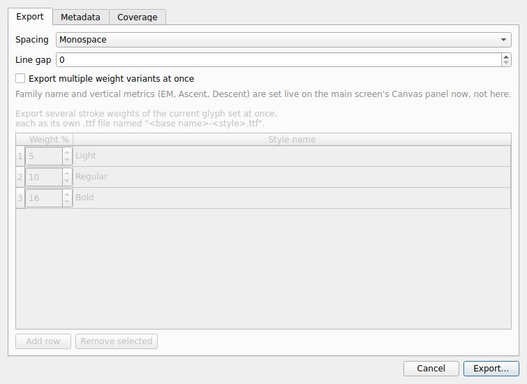
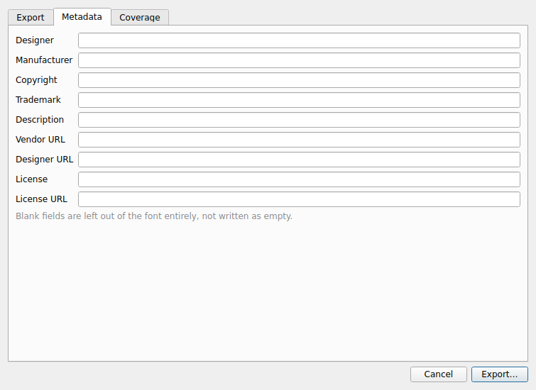
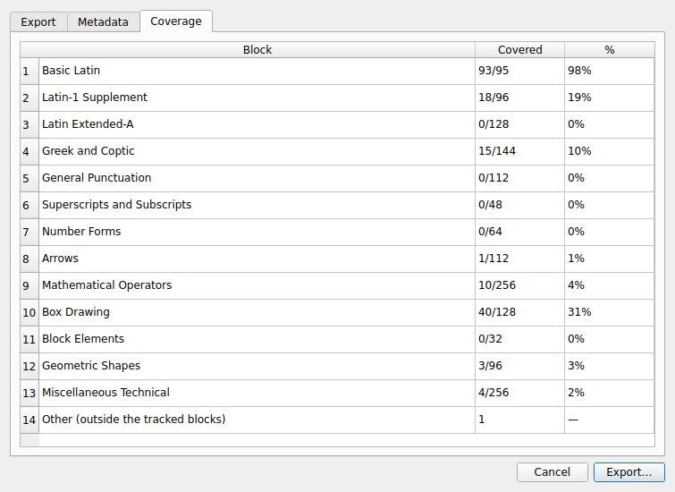
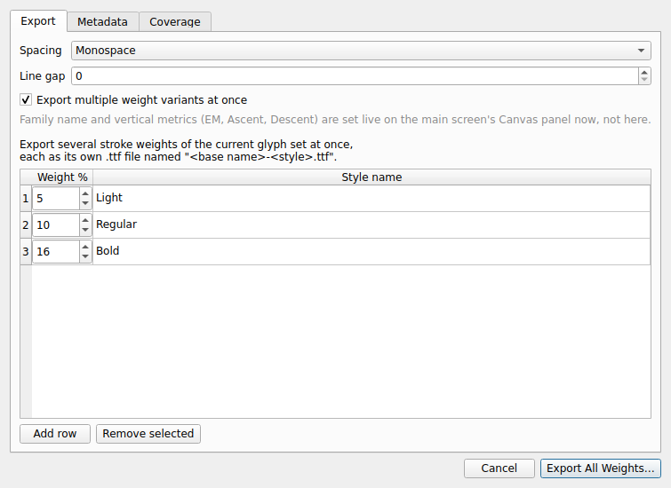

# Export

Click **Export TTF** on the toolbar to open the export dialog, with three tabs.

## Export tab

- **Spacing** — Monospace or Proportional advance widths.
- **Line gap** — extra vertical spacing between lines of text, in font units.
- **Export multiple weight variants at once** — see [Multi-weight batch export](#multi-weight-batch-export) below.

Family name and vertical metrics (units per EM, Ascent, Descent) aren't set here — they're live on the main screen's [Canvas panel](metrics-and-canvas.md), so whatever's currently showing there is what gets exported.

## Metadata tab

Name-table fields written into the font file: **Designer**, **Manufacturer**, **Copyright**, **Trademark**, **Description**, **Vendor URL**, **Designer URL**, **License**, **License URL**. A field left blank is omitted from the font entirely, not written as an empty string.

## Coverage tab

A read-only report of how much of each Unicode block your current glyph set covers — how many codepoints exist in that block, how many you have, and the resulting percentage. Useful for checking progress on a specific script or symbol range before exporting.

## Multi-weight batch export

Check **Export multiple weight variants at once** (on the Export tab) to reveal a small table: each row is one stroke weight (as a percentage) and a style name, exported as its own `.ttf` file named `<base name>-<style>.ttf`. Starts pre-filled with a Light/Regular/Bold spread around the glyph set's current weight; use **Add row** / **Remove selected** to adjust. Weight percentages are capped at 50%.

This exports the *same* glyph shapes at each listed weight — it isn't a way to maintain separately-edited weight variants, just a convenience for producing a family of `.ttf` files from one glyph set in a single pass.
