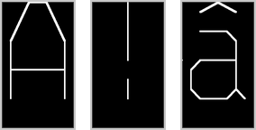
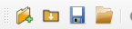
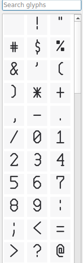
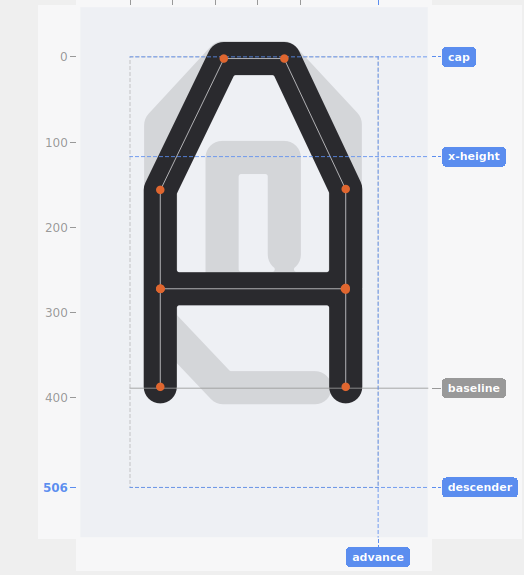
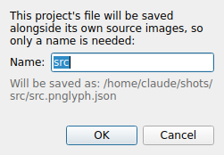
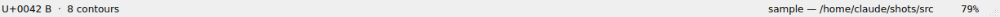

# Getting started

## Source images

PNGlyph builds a font from a folder of PNG files, one per character, named `u<hex>.png` — the codepoint in lowercase hex. For example:

- `u0041.png` → `A`
- `u0021.png` → `!`
- `u00e2.png` → `â`

Each PNG should show the glyph as a **stroke skeleton** — thin, single-pixel-wide lines describing the shape's centerline, not a filled/outlined letterform. PNGlyph traces these skeletons into polylines, then thickens them to a chosen stroke weight at export and edit time. A blank or missing file for a codepoint just means that glyph isn't included yet.

### What makes a workable source PNG

A few concrete requirements, confirmed directly against how tracing actually reads a file:

- **Polarity is auto-detected, but the image still needs to actually be two clean tones.** Tracing works out which of the two dominant colors in a source is ink and which is background on its own — white-on-black and black-on-white both trace correctly, with no setting to configure either way. What it can't do is invent contrast that isn't there: a source needs a real, sharp separation between its ink and background color for that detection to work confidently in the first place.
- **Stroke width, comfortably above ~2px** — below that, tracing becomes unreliable (PNGlyph warns when it detects this, but a genuinely too-thin source can't be fixed after the fact by the warning alone). A screen capture is a common way to end up here without realizing it: a character extracted from a full-screen capture at, say, 60×100px can look fine by eye but trace incorrectly, since the resolution simply isn't there to begin with — no amount of upscaling afterward recovers detail that was never captured.
- **Contrast**: ink and background are read against two fixed brightness bars, deliberately not an adaptive per-image threshold — an adaptive version of this was tried and reverted after it was confirmed to occasionally produce a confidently wrong trace on a source with an unlucky mix of extreme size imbalance (an ordinary single glyph on a normal canvas) and marginal contrast, rather than failing in an obviously visible way. The trade-off is that a source with genuinely soft/anti-aliased edges or a not-quite-flat background can fail to register as clean ink — PNGlyph warns when it detects this (see [Capture mode](capture.md) for why this comes up far more often for a screen capture than a purpose-prepared PNG), and when it happens the fix is the source image itself, not a setting: an ordinary image editor's contrast/levels tool (IrfanView and other free tools all work fine for this) can flatten a marginal source before it's imported or captured. Flat black and flat white, not a gradient or a compressed/lossy source, still works most reliably.

If a glyph's source PNG genuinely can't be traced — missing from disk, or too corrupt to decode — PNGlyph falls back to an empty glyph with a status message rather than crashing. The same fallback applies to the onion-skin reference overlay (see [Drawing](drawing.md#onion-skin)) if its own source has the same problem.

### Canvas size

The working canvas size is auto-detected as the most common dimensions among your source PNGs. If your files don't all agree on one size, PNGlyph warns you which size won it and how many files differ (a small, few-pixel difference is treated as export/rounding noise and not flagged at all) — worth checking a real mismatch, since a stray, differently-sized file (a re-export, a different tool's output) will still trace and edit normally, just against a canvas that doesn't actually match its own pixels.

PNGlyph is built around small, DOS-era-scale bitmap fonts — historically rarely more than 32×32 pixels per glyph — plus a deliberately simple from-scratch mode of similar scope (straight segments only, no curve or arc tools), scaled up to a comfortable editing resolution. Both very small and very large canvases get a confirmation prompt rather than a silent pass-through, and the same applies whether the size came from auto-detection or was typed directly into a from-scratch project:

| | Largest/smallest canvas dimension (px) | What happens |
|---|---|---|
| Soft lower limit | below 250px | Confirmation prompt — low-resolution source traces unreliably, and a from-scratch project this small tends to look blocky once exported at a higher resolution. |
| **Optimal range** | **375–625px** | No prompt — this is the sweet spot, close to PNGlyph's own original reference set. |
| Soft upper limit | above 750px | Confirmation prompt — technically fine, just increasingly disconnected from what the tool's own defaults are tuned for. |
| Hard upper limit | above 3675px | Refused outright — a full-featured vector editor is a better fit at this scale. |

There's no hard *lower* limit the way there is an upper one — tracing degrades gradually as resolution drops rather than failing outright at a specific number, so the soft-lower prompt is the only guardrail on that side.

Endpoint dots, skeleton lines, and guide lines all scale their on-screen thickness with the glyph's own cap height, so they look visually consistent whether the canvas is tiny or huge — the same reasoning stroke weight already uses. This is purely visual: it never affects click precision or snap distance, which stay fixed regardless of canvas size (see [Snapping](snapping.md#why-the-snap-distance-is-fixed-not-adjustable)) — a large dot on a small canvas doesn't mean a larger click target, just a clearer-looking one. Dragging a guide is a related but different case: its pill always moves in exact lockstep with the mouse on screen, so precision there comes from how far you've zoomed in rather than from canvas size at all — see [Snapping](snapping.md#guide-drag-speed-and-range) for the full behavior, including how far a guide can move in one drag.

## Opening a source folder, or reopening a saved project

**New** is the way in the vast majority of the time: point PNGlyph at a folder of raw `u<hex>.png` files, nothing else required. This:

1. Scans the folder for every `u<hex>.png` file present.
2. Auto-calibrates the font's vertical metrics (cap height, x-height, baseline, descender) and advance width by analyzing a set of reference glyphs.
3. Traces every glyph's skeleton and populates the glyph list on the left.

**Open** only becomes relevant *after* you've saved at least once (see [Saving your work](#saving-your-work) below) — it reopens that saved `.pnglyph.json` project file, restoring your edits alongside a fresh trace of the source PNGs. There's nothing to open the very first time you work with a given source folder.

Calibration is a starting point, not a final answer — see [Metrics and canvas](metrics-and-canvas.md) for how to review and adjust it.

## The glyph list

The left-hand panel lists every glyph PNGlyph found, each with a live preview icon. Type in the search box to filter by character or codepoint. Click a glyph to load it into the canvas.

Glyph icons update automatically as you change weight, cap style, or edit a glyph's shape — see [Weight and Size](size-and-weight.md) for how that refresh is kept fast even on large glyph sets.

## The canvas

The center pane shows the currently-loaded glyph: its traced skeleton, the thickened stroke preview, and the guide lines for cap height, x-height, baseline, and descender. This is where all direct editing happens — see [Selection and editing](selection-and-editing.md) and [Drawing](drawing.md).

**Navigating the view** doesn't interfere with editing, since it uses buttons/actions editing never does:

- **Scroll wheel** zooms in and out, centered on the cursor. Zooming out is capped at the glyph's own "fit" scale — you can't scroll past the point where the whole glyph and its guides are already fully visible.
- **Right-click-drag** pans the view.
- **Fit to window** (toolbar) resets the view to that same fit scale directly, without scrolling back to it by hand.

## Undo and redo

Undo/Redo (Ctrl+Z / Ctrl+Y) is **segment-level only** — draw, cut, paste, break, join, group — and strictly scoped to whichever glyph is currently on the canvas. Switching glyphs doesn't carry an undo/redo history over from the one you left.

Adding, replacing, or deleting a glyph itself is **not** undoable — only in-glyph drawing edits are. To back out of adding or replacing a glyph, use "Remove from project" or re-import/re-capture it instead.

## Saving your work

Saving is optional, and creates the `.pnglyph.json` file mentioned above for the first time — nothing needs to exist before this point. It doesn't store baked-in glyph shapes; it stores calibration, font settings, and a per-glyph list of *replayable edit steps*. Re-opening the project re-applies those steps to the current source PNGs. This means:

- If you update a source PNG later, your existing edits replay on top of the new trace automatically.
- Two project files can be diffed to see exactly what changed, edit by edit.

### Where the project file lives

The `.pnglyph.json` always lives in the same folder as its own source PNGs, and its source folder is always derived from wherever that `.json` file itself currently sits — never separately stored inside the file. Practically, this means **you can move or rename the whole project folder freely**, at any time, without breaking anything; there's no stale path left pointing at the old location to go wrong.

Source PNGs aren't touched the moment you add or replace a glyph, either. A new or replaced source image is staged in a hidden folder alongside the originals, and only actually written into place when you save — so nothing on disk changes until you decide to keep it. Any staged file left over from a replacement you never saved is cleaned up automatically the next time the project loads; a staged file still referenced by the project survives.

If a project loads and one or more of its glyphs' source PNGs are missing, PNGlyph shows you the list and asks whether to remove those glyphs from the project. Declining keeps them (still pointing at the missing file); removing them isn't saved automatically — it's just the in-memory project state, same as any other edit, until you save.

### Naming and saving

The **first** time you save a project, PNGlyph asks for a name only — never a full save-as path or folder to browse to, since the file has nowhere else valid to go — with a live preview of the resulting filename as you type:

Every save after that is silent: same path, no dialog. The status bar permanently shows **"project name — folder"**, eliding the folder portion with `…` when it's too long to fit (hover for the full path via tooltip):

Use **Save**/**Load** on the toolbar for the project file itself; use **Export TTF** (see [Export](export.md)) to produce the actual font file.

## A first export

Once you're happy with a glyph set — even a small one, to check the pipeline works — click **Export TTF** on the toolbar. See [Export](export.md) for the full dialog (spacing, metadata, coverage, multi-weight batch export).
