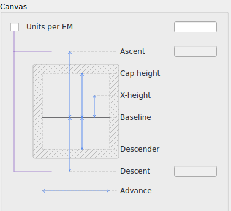
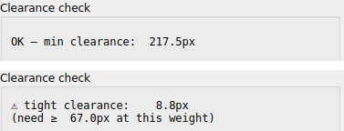

# Metrics and canvas

## The Canvas panel

Shows the font's vertical metrics as both a diagram and editable fields: **Units per EM**, **Ascent**, **Cap height**, **X-height**, **Baseline**, **Descender**, **Descent**, and **Advance** width.

**Ascent and Descent aren't independent fields by default.** The small checkbox next to Units per EM controls this: unchecked (the default), both are derived automatically — Ascent from Units per EM via a fixed formula, Descent from your actual traced descender proportions when there's enough calibration data to measure them, falling back to a Units-per-EM-based formula otherwise. Checking the box lets you set either one directly, useful when a specific value is required — matching an existing font family's own metrics, for instance. Cap height, X-height, Baseline, and Descender are always independent, editable fields regardless of this checkbox; it only ever governs Ascent and Descent.

These are auto-calibrated from your source PNGs when a project is first opened (see [Getting started](getting-started.md)), and can be adjusted here afterward — every open glyph's guide lines update to match immediately.

If calibration can't establish real metrics from a folder import (too few usable reference glyphs, for instance), any values it can't derive are filled in with sensible fallback proportions rather than left blank or zero — you can still review and adjust every field here afterward the same as normal.

Guide lines (cap height, x-height, baseline, descender) are also directly draggable on the canvas itself, which is the same adjustment as editing the field here, just done visually against a specific glyph rather than by typing a number.

## Line endings

**Round** or **Flat** — see [Weight and Size](size-and-weight.md#cap-style).

## Clearance check

Flags glyph pairs whose strokes may end up touching once thickened to the current weight, without needing to eyeball every glyph by hand.

- **`OK — min clearance: N px`** — the closest two points across all checked glyphs are at least far enough apart at the current weight.
- **`⚠ tight clearance: N px (need ≥ M px at this weight)`** — flags a pair that may collide once thickened.

This is a **filter, not an oracle**: it's tuned to skip ordinary junctions (where strokes are deliberately meant to meet) automatically, but it can still flag a genuinely fine near-crossing diagonal as a false positive. Treat a warning as "worth a quick look," not "definitely broken" — the goal is narrowing down which handful of glyphs (out of what might be hundreds) are worth checking by eye, not replacing that check entirely.

Clearance is checked against the current stroke weight, so a warning can appear or disappear as you adjust [Weight](size-and-weight.md).
