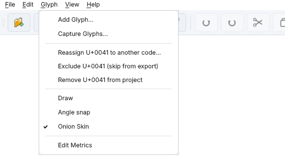
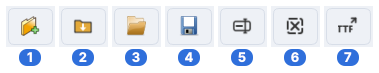
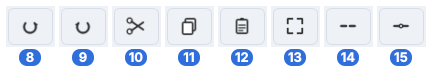
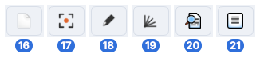
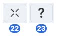

# Reference

Every menu, toolbar command and keyboard shortcut, in one place, for a quick "what does this do" lookup — see the topic pages for the full explanations behind each one.

## Menus

Every command is in the text menus as well as on the icon toolbar — they're the same commands, so enabled/checked states always match. **View → Icon toolbar** hides or shows the toolbar (remembered).

| Menu | Commands |
|---|---|
| **File** | New Project…, Import PNG folder…, Open project…, Save project…, Rename project…, Clear Project, Export TTF, Exit |
| **Edit** | Undo, Redo, Cut, Copy, Paste, Delete, Select all, Break, Join |
| **Glyph** | Add Glyph…, Capture Glyphs…, Reassign *U+XXXX* to another code…, Exclude/Include *U+XXXX*, Remove *U+XXXX* from project, Draw, Angle snap, Onion Skin, Edit Metrics — Reassign/Exclude/Remove act on the glyph on the canvas |
| **View** | Fit to window, Icon toolbar |
| **Help** | Help, About PNGlyph |

## Toolbar

The icon toolbar has the same four groups, in the same order, as the [menus](#menus) — Help sits with View. The numbers below each picture match the first column of its table. Hover any icon in the program for its name.

### File

| # | Shortcut | Command | Does |
|---|---|---|---|
| 1 |  | **New Project…** | Start a project from scratch, no source PNGs — see [Getting started](getting-started.md). |
| 2 |  | **Import PNG folder…** | Import a folder of `u<hex>.png` source glyphs — see [Getting started](getting-started.md). |
| 3 |  | **Open project…** | Open a previously-saved project. |
| 4 |  | **Save project…** | Save the current project (`.pnglyph.json`). |
| 5 |  | **Rename project…** | Rename the current project's file, optionally its folder too — saved projects only (an unsaved one is offered Save now…). Also on the status-bar project name's right-click menu. See [Getting started](getting-started.md#naming-and-saving). |
| 6 |  | **Clear Project** | Remove the current project from memory — nothing on disk is deleted; asks first, and offers to save unsaved changes. Optionally also resets every remembered setting (folders, capture size, character table and toolbar choices…). |
| 7 |  | **Export TTF** | Open the export dialog (spacing, metadata, multi-weight, coverage) — see [Export](export.md). |

### Edit

| # | Shortcut | Command | Does |
|---|---|---|---|
| 8 | Ctrl+Z | **Undo** | Undo the last in-glyph edit — segment-level only, scoped to the current glyph. See [Getting started](getting-started.md#undo-and-redo). |
| 9 | Ctrl+Y | **Redo** | Redo the last undone edit. |
| 10 | Ctrl+X | **Cut** | Cut the selection — same whole/piece distinction as Delete, see [Selection and editing](selection-and-editing.md). |
| 11 | Ctrl+C | **Copy** | Copy the selection. |
| 12 | Ctrl+V | **Paste** | Attaches the clipboard to the cursor; click to place. Replaces any current selection. |
| 13 | Ctrl+A | **Select all** | Select every segment in the current glyph. |
| 14 |  | **Break** | Break the selected segment(s) off so they can move independently — see [Selection and editing](selection-and-editing.md#join-and-break). |
| 15 |  | **Join** | Join the selected segments back into one polyline, or into a group if they don't connect end-to-end. |

### Glyph

| # | Shortcut | Command | Does |
|---|---|---|---|
| 16 |  | **Add Glyph…** | Add a new glyph — blank to draw from scratch, or from one or more source PNGs via a codepoint-assignment review window. See [Adding glyphs](adding-glyphs.md). |
| 17 |  | **Capture Glyphs…** | Build glyphs by screen-grabbing regions of any on-screen reference — see [Capture mode](capture.md). |
| 18 |  | **Draw** | Enter/exit the pen tool — Escape (with no stroke in progress) or right-click → Stop drawing also leaves it. See [Drawing](drawing.md). |
| 19 |  | **Angle snap** | Constrain dragged points and new strokes to 22.5° steps — see [Drawing](drawing.md#angle-snap-while-drawing). |
| 20 |  | **Onion Skin** | Toggle a faint outline of the nearest already-drawn glyph as a weight/proportion reference. |
| 21 |  | **Edit Metrics** | Show the guides without any glyph selected, for adjusting metrics on their own. |

### View

| # | Shortcut | Command | Does |
|---|---|---|---|
| 22 |  | **Fit to window** | Reset the view to fit the current working area. |
| 23 | F1 | **Help** | Open this Help viewer. |

## Keyboard-only

Not on the toolbar, but active in specific contexts:

| Key | Where | Does |
|---|---|---|
| **G** | Any drag or draw | Toggles Snap to grid on/off — see [Snapping](snapping.md#held-key-overrides). |
| **S** | Any drag or draw | Toggles Snap to segments on/off. |
| **E** | Any drag or draw | Suspends segment snap's point-priority while it's otherwise active, falling straight through to line-snap — see [Snapping](snapping.md#snap-to-segments). |
| **H** | Any drag or draw | Toggles Snap to x-height/baseline on/off. |
| **Ctrl** | Any drag or draw | Bypasses every snap setting for that one drag or point placement — see [Snapping](snapping.md#bypassing-snap-entirely). |
| **Enter/Return** | Drawing | Finishes the current stroke. |
| **Double-click** | Drawing | Also finishes the current stroke — see [Drawing](drawing.md#the-pen-tool) for a small difference from Enter worth knowing. |
| **Backspace** | Drawing | Removes the last-placed point. |
| **Escape** | Draw mode | With a stroke in progress: discards the stroke (Draw mode stays on). Otherwise: leaves Draw mode. |
| **Delete** | Drawing, or a selection | Discards the in-progress stroke, or deletes the current selection. |
| **Scroll wheel** | Canvas | Zooms in/out, centered on the cursor. |
| **Right-click-drag** | Canvas | Pans the view — also while a paste is attached, which stays attached. |
| **Right-click** | Canvas, paste attached | Cancels the paste. |
| **Right-click** | Canvas, on a point | The context menu offers **Align grid to this point** — see [Snapping](snapping.md#aligning-the-grid-to-a-point). |
| **Ctrl+U** | Any codepoint field | Starts hex entry (`U+XXXX`) — see [Capture mode](capture.md#assigning-codes). |
| **Drag from empty space** | Canvas | Draws a selection box — see [Selection and editing](selection-and-editing.md#drag-box-select) for the Ctrl/Shift modifiers. |
