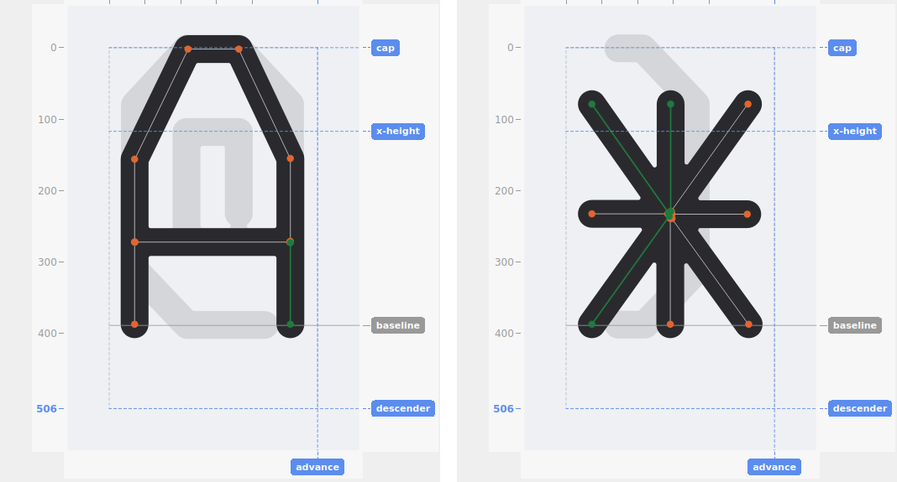
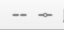
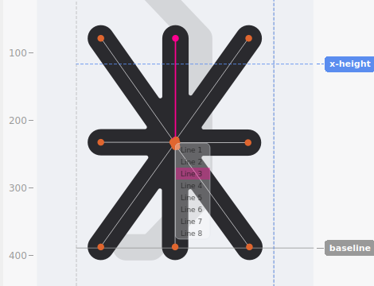
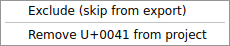
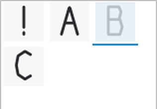

# Selection and editing

## The three kinds of click

- **Plain click** on a segment selects just that one segment and activates its two endpoints — they become draggable, and you can click either one to move it. If the segment is part of a polyline or group, only that one segment is selected this way (not the whole unit) — see [Polylines vs. groups](#polylines-vs-groups) below for what a plain click-and-drag does differently. Clicking elsewhere (or a different segment) replaces the selection.
- **Shift-click** is primarily an *addition* to whatever's already selected — via a previous plain click or a drag-box selection — adding a whole *unit* (a polyline, a group, or a standalone segment) as a rigid block, tinted rather than made individually draggable. It works perfectly well as a first click too, with nothing selected yet. Dragging anywhere on a Shift-selected unit moves the whole thing together. Shift-click again on the same unit to remove it from the selection.
- **Ctrl-click** is also primarily additive — toggling one specific item into or out of an existing selection without disturbing the rest, most useful right after a Shift-click grabbed a bigger unit (a group or polyline) than you meant, letting you trim one piece back out. Like Shift-click, it works standalone too, with nothing selected beforehand.

## Drag-box select

Click and drag from empty canvas space to draw a selection box — every segment with at least one endpoint inside it gets selected, the same piece-level selection a plain click gives (a fully-caught polyline or group ending up entirely selected is just every one of its pieces individually qualifying, not a deliberate whole-unit pick). A plain drag-box replaces whatever was already selected, the same as a plain click does.

The same two modifiers work here too, with the same meaning they have everywhere else in this doc:

- **Ctrl** makes it additive — each caught segment toggles into or out of the selection individually, including carving an already-Shift-selected piece back out. A box that happens to catch only one segment behaves identically to Ctrl-clicking that segment directly.
- **Shift** expands every caught segment to its whole unit, the same as Shift-click. Stays additive across multiple separate box-drags for as long as Shift is held continuously — draw one box, keep Shift down, draw another elsewhere, and the second adds to the first. Releasing Shift and pressing it again starts a fresh selection instead.

## Polylines vs. groups

A **polyline** is one continuous, multi-point stroke traced as a single path — an ordinary letter's stem-and-curve, for example. A **group** is a set of otherwise-separate paths explicitly tied together (see **Join**, below) so they move as one unit under a Shift-click drag, without actually merging into one continuous line.

Clicking a *specific* segment within a polyline or group (rather than Shift-clicking the whole thing) still selects just that segment — its own two endpoints become active — while the rest of its unit shows the weaker "family" tint, so you can always see what it belongs to without losing the ability to adjust one piece precisely.

A plain click-and-**hold** on any segment of a polyline or group, dragged without releasing, moves the *entire* polyline or group immediately — the same single gesture that would otherwise just select that one segment. This holds regardless of how the unit came to exist (traced as one continuous polyline, or joined together as a group): moving any segment of a rigid unit moves all of it. Endpoints are the one exception — they always drag individually, whether they belong to a standalone segment, a polyline, or a group. Whichever point in the whole unit sits nearest to where you actually clicked becomes the one snapping is calculated against for the rest of that drag — not the literal click position itself — since clicking exactly on a point would otherwise start a single-point drag instead. That's what lets a whole polyline or group snap cleanly into the grid or onto existing geometry at all, even though you didn't click precisely on one of its own points to start the drag.

## Join and Break

Both work on whatever's currently selected, and both decide what to do based on the geometry:

- **Join**, given two or more selected paths whose endpoints connect end-to-end, merges them into one continuous polyline. If they *don't* connect that way, Join creates a **group** instead — treating the whole selection as one movable unit without changing any geometry. (Any multi-point polyline among the selection is first split into individual segments, since a group's members are always atomic segments, never polylines.)
- **Break** undoes either: a selected member of a group is simply removed from that group (no shape change), while a selected segment within an ordinary polyline is split apart geometrically at that point.

## The disambiguation popup

Sometimes a click genuinely could mean more than one thing — a few segments meeting at nearly the same point, for instance. Rather than silently guessing, PNGlyph shows a small popup listing every plausible candidate as "Line 1", "Line 2", and so on (with "(polyline)" or "(group)" noted where relevant).

- **Hover** a row to preview exactly what picking it would select — the candidate segment and both its endpoints highlight in a distinct color, live on the canvas.
- **Click** a row to commit that selection.
- **Move the mouse away, or click elsewhere**, to dismiss the popup with no selection change at all.

This only ever appears for a genuinely fresh, ambiguous click. If something is already selected and you click on *its own* geometry, that always wins outright — no popup, no ambiguity to resolve.

## Cut, Copy, Paste

Standard shortcuts (Ctrl+X/C/V) work on the current selection:

- **Copy** captures whichever paths are selected — a whole path if every one of its segments is selected, or just the individual 2-point pieces otherwise. Group relationships are preserved. Only what's actually selected is copied — the weaker "family" tint shown on the rest of a polyline or group when you plain/Ctrl-click just one of its segments (see [Polylines vs. groups](#polylines-vs-groups) above) is not a selection, and none of that tinted geometry is included.
- **Cut** copies, then deletes the selection.
- **Paste** attaches the clipboard to the cursor as a shaded preview, following it until you left-click to place — the click commits the paste at that position, replacing whatever's currently selected (same as Delete). The point that actually follows the cursor is the topmost, then leftmost, real vertex among whatever was copied — never a synthetic bounding-box corner — chosen specifically so that point lands exactly on a snap target when you place it near one, giving the pasted content precise, snapped alignment with the rest of the glyph through that one point. Pasting near the canvas edge clamps the entire pasted selection's bounding box within canvas bounds — not just the point you click — so a paste can't land partly outside the canvas.

Paste works across glyphs too — copy a segment from one glyph, switch glyphs, and paste it into the new one.

## Deleting

**Delete** or **Backspace** removes every currently-selected segment.

## Exclude and Include

A glyph can be marked **Excluded** — a soft "leave it out of the exported font" flag, not a deletion. Its source PNG is never touched or removed; excluding a glyph only changes whether it's included the next time you export.

Right-click a glyph in the list to toggle it:

- Right-clicking a **single** glyph shows a plain toggle — Exclude or Include, whichever applies to its current state.
- Right-clicking with **multiple** glyphs selected always shows both options, applying uniformly to the whole selection regardless of each glyph's own prior state.

An excluded glyph appears grayed out and faded in the glyph list, with a tooltip explaining why:

Its canvas also becomes **read-only** while it's the one loaded: left-click, Delete, Draw mode, Paste mode, and Select all are all blocked, including right-click-to-select on a segment, polyline, or group (which would otherwise still open a fully-functional Cut/Copy/Paste/Delete menu). Right-click-**drag** panning still works — viewing and navigating an excluded glyph is fine, only editing it isn't.
