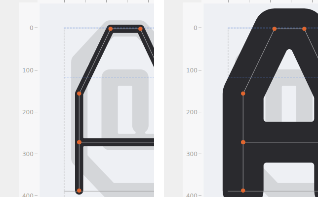
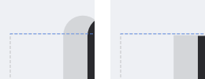
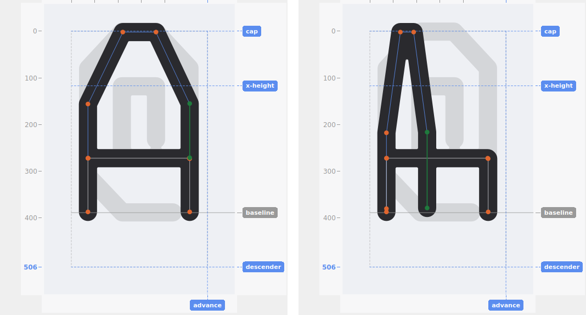
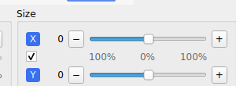

# Weight and Size

## Weight

The **Weight** slider sets stroke thickness as a percentage of cap height (1%–30%), applied live to the currently-loaded glyph and, on release, baked into that glyph's edit recipe. **Skeleton only** shows just the traced centerlines without the thickened outline — a faster redraw for a glyph with a lot of points, useful while making a lot of small point adjustments in quick succession.

Changing weight also refreshes the glyph list's icons and, if onion skin is on, the reference outline — see [Drawing](drawing.md#onion-skin). On a large glyph set, only the icons currently scrolled into view refresh immediately; the rest catch up automatically the moment they scroll into view, so adjusting weight stays fast regardless of how many glyphs the project has.

## Cap style

**Round** or **Flat** line endings, next to Weight — affects both the rendered stroke and, correctly, the actual clickable hit-region around each segment's endpoints (a round cap's rendered bulge past the endpoint is also part of what you can click).

## Size — Flatten and Stretch

The **Size** panel scales a selection's variation independently on the X and Y axes, relative to a fixed anchor point (leftmost point for X, topmost for Y) — compressing it toward that anchor (**Flatten**) or exaggerating it past the original (**Stretch**).

- **Center (0)** on either slider is always the original, unedited shape for that axis — moving left flattens (down to fully flat at −100), moving right stretches (up to double the original variation at +100).
- The value shown is a plain signed number, no percent sign — the slider's own position already tells you which side (Flatten vs. Stretch) you're on.
- Both sliders react live as you drag; the edit only commits (as a single undo step) when you release, or use the **−**/**+** fine-adjustment buttons.
- Results are clamped to the glyph's own working-area bounds, so an aggressive Stretch can't push a point outside the canvas.

Touching a Size slider always measures from the shape as it was **when the current selection began** — if you drag a point (or a whole segment) to a new position first, Size's own reference updates to match, so a later slider adjustment builds on your drag rather than reverting it.

### Linking X and Y

Check the small box between the two sliders to move X and Y together — both sliders track the same value while linked, shown by both axis labels taking on the checkbox's own blue tint.

Toggling the link (in either direction) commits whatever's currently on screen as its own undo step, then starts fresh from 0 on both axes — the shape itself doesn't visibly change at that instant, but it guarantees the full −100…100 range stays available afterward regardless of where the sliders happened to be. (Composing the old, independent X/Y values instead would risk one axis hitting its own limit before the other finished.) Switching to a different selection or glyph automatically un-links, so a fresh selection never starts in a state that looks active but is actually disabled.
