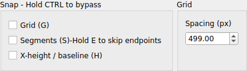
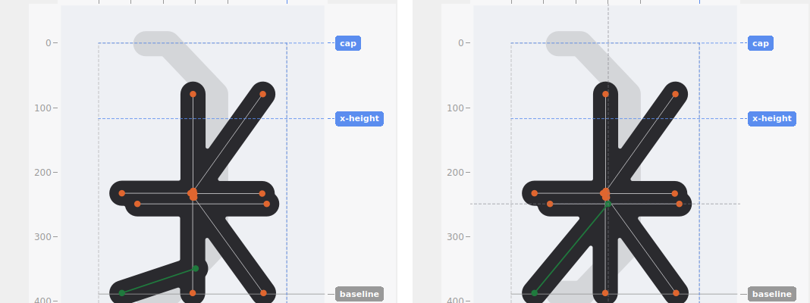

# Snapping

Snap settings live in the **Snap** and **Grid** boxes and apply whenever you drag a point, drag a whole segment/group, drag a guide, or place a point with the pen tool.

## Snap to grid

Snaps to the nearest grid intersection. Grid spacing (in px) is set in the same panel; a spacing of `off` disables the grid entirely without unchecking the box. Applies to guides too — dragging any guide (cap, x-height, baseline, descender, advance) snaps it to the nearest grid line along its own axis.

## Snap to segments

Snaps to nearby glyph geometry — **points first, then lines**, whichever is closer, with point taking unconditional priority whenever it's within range at all (not just on a near-tie). This is a fixed, weight-independent distance in both cases — how close counts as "close enough" doesn't change as you adjust stroke weight, so a thick stroke's own visual bulk never makes snapping (or ordinary clicking) feel like it has a different effective range than a thin one.

Point priority is unconditional, so an unrelated endpoint sitting near the line you're actually trying to snap *to* can "steal" the snap, even if it has nothing to do with that line. Hold **E** to temporarily suspend endpoint-priority while segment snap stays otherwise live — falling straight through to line-snap for as long as it's held, no matter whether segment snap is currently on via its checkbox or via pressing S.

**Self-exclusion.** A point can't snap to its own, currently-moving position, or to a segment's own line while that same segment is what's being dragged — both would otherwise create a target that moves together with the drag itself. This exclusion releases the moment you actually move away from wherever the drag started (past the snap tolerance, once), so you can still deliberately snap back onto that same original spot later in the same drag.

Leaving this on is worth doing even beyond keeping shapes visually tidy: a point that lands *exactly* on an existing point or line, rather than merely close to it, is far easier to click precisely later — near-but-not-quite-coincident geometry is exactly the situation that makes a later click feel ambiguous or triggers the [disambiguation popup](selection-and-editing.md#the-disambiguation-popup) unnecessarily.

This also extends to guides: dragging any of the four horizontal guides (cap, x-height, baseline, descender) snaps to an existing point's height, and dragging advance snaps to an existing point's own X position — useful for exact alignment, like setting baseline to precisely match where a shape was already drawn.

## Why the snap distance is fixed, not adjustable

The distance used for both point- and line-snapping is a constant, not a setting — deliberately. A glyph's own structure doesn't change depending on how large its canvas happens to be; only the *number of points describing it* does, so a snap tolerance based on canvas size would make the exact same physical mouse movement mean something different from one project to the next, for no reason connected to the actual geometry. Keeping it fixed means snapping (and ordinary click precision, which shares the same underlying tolerance) behaves identically regardless of canvas size.

This is separate from how endpoint dots, skeleton lines, and guide lines are *drawn* — their on-screen thickness does scale with the glyph's own cap height, the same way stroke weight already does, so they look visually consistent at any canvas size (see [Getting started](getting-started.md#canvas-size)). A bigger-looking dot on a large canvas is a rendering choice, not a bigger target — the actual click/snap region underneath it is exactly the same fixed size either way.

## Guide-drag speed and range

A guide's pill always moves in exact lockstep with the mouse on screen — one physical pixel of mouse travel is one pixel of visible pill movement, at any zoom level. Precision comes purely from how far you've zoomed in, the same as ordinary point-dragging already works: zoomed out to see the whole canvas, a drag covers ground quickly; zoomed in for fine placement, the same physical movement covers far less scene distance, giving finer control automatically. There's no separate "precise" modifier — zooming in *is* the precise mode.

A guide can't be dragged past whatever's currently visible in the canvas. Zoomed out, that's the whole canvas, so this is rarely noticeable. Zoomed in for fine work, it means a guide can't suddenly leap off screen from a single drag gesture — reaching further requires deliberately zooming back out first, rather than an automatic pan doing it for you. This is also why the view never rescales *during* a guide drag: constantly resizing the visible area while dragging removed any stable sense of how close a guide was to the edge or to another guide, and — for cap and descender specifically — could make the view's own scale swing wildly as the two converged.

If two guides sit at the same, or very close, values, their pills can overlap and become hard to tell apart or click individually — this is a known limitation, not something worth engineering around directly. Zooming in resolves it on its own: the pills are positioned from the guides' own scene values through the same mapping described above, so any two genuinely different values eventually separate into distinct, individually-clickable pills the more you zoom in, even if they're only a fraction of a source pixel apart.

## Snap to x-height / baseline

Y-only: locks a dragged or drawn point's height to whichever of the x-height or baseline guide is closer. Takes precedence over grid/segment snap for the Y coordinate specifically when more than one snap mode is active at once (a point can still snap in X via grid/segments even while this decides its Y).

## Held-key overrides

**G**, **S**, and **H** each *toggle* their matching checkbox directly — press once to turn it on, press again to turn it off, exactly as if you'd clicked the checkbox itself. They used to be momentary (forcing snap on only while held), but holding more than one down at once for a combined snap turned out to be cumbersome in practice, so all three are plain toggles now.

| Key | Toggles |
|---|---|
| **G** | Snap to grid |
| **S** | Snap to segments |
| **H** | Snap to x-height / baseline |

**E** is a genuinely different kind of key, and still works the old way — held, not toggled: a modifier on segment snap specifically, suspending its point-priority for exactly as long as it's held, while segment snap otherwise stays exactly as active as it already was. See [Snap to segments](#snap-to-segments) above. It's called out directly on the **Segments (S)** checkbox's own label now, not just its tooltip, since it's easy to miss otherwise.

## Bypassing snap entirely

Hold **Ctrl** during a drag to bypass every snap setting — grid, segments, and x-height/baseline alike — for the duration of that one drag, without touching any checkbox or held-key state. This applies to guides too: on a small canvas, an existing point's fixed snap radius can be a large enough fraction of the whole canvas to keep re-grabbing an otherwise smooth, deliberate drag — Ctrl gives genuinely uninterrupted movement when that's in the way.
